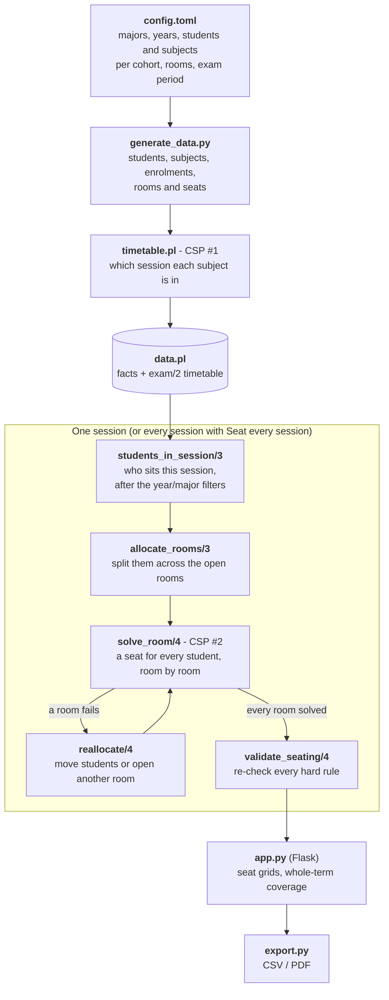

# SmartExamSeat

University exam seating arrangement planner, written as a **Constraint
Satisfaction Problem in Prolog** with a Python/Flask admin interface.

| | |
|---|---|
| 67011158 | Kyi Thant Sin |
| 67011619 | May Nyein Chan |
| 67011653 | Saw Zi Dunn |

---

## 1. How it works



```
config.toml → Data + Timetable → Allocation → Seat Solver → Validator → UI → CSV/PDF
                (CSP #1)                        (CSP #2)      
```

### Step by step

**Once per term (before the exams)**

1. **Describe the term.** In `config.toml` the administrator sets the majors,
   the year levels, how many students and subjects each (major, year) cohort
   has, the rooms, and the exam period (days x time slots = sessions).
2. **Generate the data.** `make data` runs `generate_data.py`, which reads
   `config.toml` and writes 2 files: `data.pl` (the full dataset, including
   the exam timetable built by `timetable.pl`) and `data_sample.pl` (a fixed
   20-student test set, not affected by `config.toml`). The data holds the
   students of every cohort, each cohort's own subjects (`se101`, `se102`,
   ... `ce203`), the enrolments, the rooms and their seats.
3. **Build the timetable (CSP #1).** `timetable.pl` is a Prolog program that
   decides which session each subject is examined in. `generate_data.py`
   calls it, and its output is included in `data.pl`. By the time `data.pl`
   is written, every subject already has its session:

   ```prolog
   exam(se101, sess1).
   exam(se102, sess3).
   ```

   No student has two exams at once, no session holds more than 80% of the
   open seats, and where it can, it avoids giving a student two exams on one
   day. If the exams cannot fit, the generator stops with a reason and leaves
   `data.pl` unchanged. How the decision is made is in section 4.6.

   **The timetable is fixed.** Once `make data` has run, `se101` is examined
   in `sess1` (Tuesday 1 Dec, 09:00-12:00) and nowhere else, and all 50
   year-1 SE students sit it then, together. Each subject gets exactly one
   session. You don't pick sessions by hand: the timetabler picks them
   automatically. The timetable stays the same until you run `make data`
   again. Re-running with the same `config.toml` gives the same timetable,
   because the seed is fixed. If you change the config (more days, different
   student counts and so on), the sessions can change.

**Look at the data before seating.** The **data page** (the `data.pl`
button at the top right of the UI, or `/data`) shows what is in the data
file: students and subjects per cohort, the timetable (which subjects and
cohorts sit in each session, with a link to seat any of them), every student
with their exams, and the rooms.

**For each session (in the UI)**

4. **Pick a session and who to seat.** The administrator chooses a session
   (e.g. Tuesday 09:00-12:00) and can narrow it by year and major. A live
   counter shows *selected / seats*, and the UI refuses a selection larger
   than the open rooms.
   - Choosing a session decides which exams are seated. Picking `sess1` seats
     everyone whose subject is in `sess1`, including the year-1 SE students
     for `se101`.
   - The year and major filters only narrow who gets seated. For example,
     `sess1` + year 1 + SE seats only those 50 students for `se101`. The
     filters can't move `se101` to another session.
5. **Collect the students.** `students_in_session/3` lists everyone sitting
   an exam in that session who matches the filters, as
   `[s(Student, Exam), ...]`.
6. **Split them across rooms.** `allocate_rooms/3` keeps each cohort
   together where it can, sends students who need an accessible seat to
   rooms that have them, and never puts more students of one exam in a room
   than the separation rule allows.
7. **Seat them (CSP #2).** `solve_room/4` in `solver.pl` gives every student
   in a room a seat by backtracking search. If a room cannot be solved, it
   says why; `reallocate/4` moves some students out and the room is tried
   again, and as a last resort another room is opened.
8. **Check the plan.** `validate_seating/4` re-checks the finished plan
   against every hard rule, independently of the solver, and explains any
   violation in a sentence.
9. **Show and export.** The Flask app draws every room's seat grid, lets you
   search for a student, and exports CSV and PDF through `export.py`. Both
   the Prolog code and the Python code use `data.pl`: Python never reads it
   directly, it queries Prolog through `bridge.py` (pyswip), which returns
   JSON.

**For the whole term**

10. **Seat every session.** *Seat every session* in the UI (or `make term`)
    repeats steps 5-8 for all 20 sessions, so every subject is seated in its
    own session. It shows a year x major table of exams seated per cohort; a
    cohort is finished when all of its exams are seated.
```

---

## 2. Install and run

```bash
sudo apt install swi-prolog          # or: brew install swi-prolog
python3 -m venv .venv && source .venv/bin/activate
pip install -r requirements.txt

make data                            # config.toml -> data.pl (+ timetable)
python3 app.py                       # http://127.0.0.1:5000
```

Run `make data` (or `python3 generate_data.py --stats`) in the project root,
with the venv active.

The `Makefile` just gives short names to longer commands you would otherwise
type by hand (`make data`, `make demo`, `make test`, ...). It doesn't build or
compile anything.

Useful variants:

```bash
python3 app.py --dataset data_sample.pl   # the 20-student smoke-test set
make demo                                 # solve every session in the console
make term                                 # whole term + coverage per cohort
make test                                 # both test suites
```

Straight from the Prolog console, no Python involved:

```bash
swipl main.pl
?- generate_seating(sess1, filters([1,2],[se,cs]), R), print_result(R).
?- generate_seating(sess1, filters([],[]), ok(A)),
   validate_seating(sess1, filters([],[]), A, Report).
?- use_sample_data, generate_seating(sess1, filters([],[]), ok(A)),
   print_room(r101, A).
```

---

## 3. Files

| File | What it holds |
|---|---|
| `config.toml` | what to generate: students and subjects per (major, year), rooms, exam period |
| `generate_data.py` | builds the dataset from `config.toml`, runs the timetabler, re-checks clashes and capacity |
| `timetable.pl` | `build_timetable/2` - the exam timetabling CSP (subject -> session) |
| `data.pl` | generated facts, including the timetable as `exam/2` |
| `data_sample.pl` | 20 students, 2 exams, 2 rooms - used by the tests and for demos |
| `rules.pl` | constants (`min_separation/1`, `max_retries/1`) and shared derived rules |
| `allocation.pl` | `students_in_session/3`, `allocate_rooms/3`, `reallocate/4`, UI helpers |
| `validator.pl` | `validate_seating/4` - independent re-check of a finished plan |
| `solver.pl` | `solve_room/4` - the backtracking seat CSP for one room |
| `main.pl` | `generate_seating/3`, the retry loop, `seat_term/2` (whole term), capacity counts, JSON helpers |
| `bridge.py` | pyswip bridge + a small Prolog-term parser |
| `app.py` | Flask admin UI and the export endpoints |
| `export.py` | CSV and PDF generation |
| `templates/`, `static/` | the web front end |
| `demo.pl` | console demonstration |
| `tests/test_prolog.pl` | 80 plunit tests |
| `tests/scenarios/` | tiny edge-case datasets for seating and timetabling |
| `TESTING.md` | every way to test the system, and how to change the dataset size |
| `tests/test_pipeline.py` | 64 Python tests (bridge, UI, data page, exports, config, capacity) |

The facts and predicates each part relies on are listed in
[section 8](#8-interface-reference).

---

## 4. The AI technique

The system solves **two CSPs in sequence**, both by backtracking search in
Prolog: first *which session* each subject is examined in (timetabling,
section 4.6, once per term), then *which seat* each student gets (seating,
sections 4.1-4.4, once per session).

### 4.1 The seat CSP

Per room:

* **Variables** - the students allocated to that room
* **Domains** - the seats of that room
* **Constraints** (all hard):

| Rule | Meaning |
|---|---|
| `one_seat_per_student` | every student gets exactly one seat |
| `seat_unique` | no seat holds two students |
| `room_capacity` | the seat exists and the room is not over-filled |
| `room_available` | closed rooms are never used |
| `accessibility` | `Access \= none` students only sit on `accessible` seats |
| `exam_clash` | nobody sits two exams in one session |
| `separation` | two students of the **same exam** in the **same row** must be at least `min_separation + 1 = 2` columns apart |
| `missing_student` | everyone who should sit the session is in the plan |

### 4.2 Backtracking search

`solver.pl` walks the student list recursively. For each student it picks a
seat with `member/2` and immediately checks the constraints; if a later
student cannot be placed, Prolog backtracks into that `member/2` and tries
the next seat. This is textbook chronological backtracking, expressed
directly as Prolog's own search:

```prolog
assign([s(StudentId, Code) | Rest], RoomId, AccessSeats, NormalFirst,
       Used, Rows, Acc, Out) :-
    domain(StudentId, AccessSeats, NormalFirst, Domain),
    member(seat(Row, Col, Type), Domain),
    \+ get_assoc(Row-Col, Used, _),                      % seat_unique
    rules:seat_fits(StudentId, Type),                    % accessibility
    exam_row_cols(Code, Row, Rows, Cols),
    rules:separation_ok(Row, Col, Cols),                 % separation
    ...
```

### 4.3 Heuristics

| Heuristic | Where | Why |
|---|---|---|
| accessible students first | `solver.pl` | students who require accessible seats get their restricted seat domain first; other students can use either seat type |
| largest exam group first, kept contiguous | `solver.pl` | gives the group most affected by separation predictable seats; seat order is column-first |
| open the smallest plausible room prefix | `allocation.pl` | starts with the fewest largest-first rooms that meet capacity, accessibility, and per-exam estimates |
| maximize cohort fit, then use a tight fit | `allocation.pl` | prefers rooms that keep the most same-exam/major/year students together and preserves larger rooms for cohorts that need them |
| group by exam, major, and year | `allocation.pl` | keeps cohorts contiguous within accessible and normal student ordering |
| per-room cap of `Rows × ceil(Cols/2)` students per exam | `rules.pl` | the allocator can prove in advance that a room is not impossible before the solver wastes time on it |
| bounded inference budget | `solver.pl` | distinguishes an inconclusive `search_limit/1` from a proven `no_solution/1` and allows reallocation |

### 4.4 Allocation retry loop

When `solve_room/4` fails it returns a *reason*:

```prolog
not_enough_seats(RoomId, Needed, Have)
not_enough_accessible(RoomId, Needed, Have)
no_solution(RoomId)
search_limit(RoomId)
```

`generate_seating/3` feeds that reason back into `reallocate/4`, which moves
students out of the broken room (accessible students for an accessibility
failure, members of the largest exam group otherwise). It tries available
capacity in existing rooms first. If bounded search and those reshuffles still
do not solve the plan, it adds a room as a final fallback. `search_limit/1`
means the search may have been inconclusive; it is not reported as a proven
`no_solution/1`. Room expansion stops when there are no unused rooms left.

### 4.5 Other Prolog techniques used

* **unification** throughout - `enrolled(Student, Code)` against the fact base
* **recursion** over students, seats and assignment lists
* **negation as failure** - `\+ get_assoc(Row-Col, Used, _)` for "seat free"
* **AVL maps** (`library(assoc)`) for the used-seat set and the per
  `(Exam, Row)` column lists, so each constraint check is `O(log n)`

### 4.6 The timetabling CSP

`timetable.pl` runs once, when the data is generated:

| | |
|---|---|
| **Variables** | every subject |
| **Domains** | the sessions of the exam period (`[exam_period]` in `config.toml`) |
| **Hard constraints** | two subjects that share a student go in different sessions (this is what guarantees the `exam_clash` rule); a session's headcount <= open seats x `max_fill_percent`; a session's accessible headcount <= accessible seats |
| **Soft constraints** | a student should not have two exams on the same day; the load should be spread evenly |

The decision is made by two predicates:

* `place/6` takes the subjects one at a time, largest first, and tries
  sessions with `member/2`. If a later subject gets stuck, Prolog backtracks
  and tries another session.
* `candidates/7` lists the sessions allowed for one subject. It drops
  sessions that break a hard rule:
  * a subject that shares a student with this one is already in that
    session (a clash);
  * the session would go over 80% of the seats;
  * the session would go over the accessible seats.

  It sorts what's left by: fewest same-day exams for those students, then
  the emptiest session, then the earliest.

The same pattern as the seat solver: `member/2` over an ordered domain, with
a bounded inference budget.

| Heuristic | Why |
|---|---|
| largest subject first, then most conflicts | the hardest subjects to place go first (fail-first) |
| session with fewest same-day conflicts first | how the soft "one exam per day" rule is honoured without making it hard |
| then the emptiest session | least-constraining value: keeps room for the subjects still to come |
| lower-bound precheck | `too_few_sessions(Need, Have)` is proven without search: Need = max(subjects per student, ceil(exam seats / session capacity), ceil(accessible exam seats / accessible seats)) |

Failure reasons: `too_few_sessions(Need, Have)`, `subject_too_large(Subject,
Size, Max)`, `no_sessions`, `no_timetable(Sessions)`. The generator prints
these as plain sentences and refuses to write `data.pl`.

---

## 5. Validation

`validate_seating/4` deliberately **does not reuse the solver's bookkeeping**.
It re-derives everything from the raw facts, so a bug in `allocation.pl` or
`solver.pl` surfaces here rather than being silently agreed with. It returns

```prolog
valid
invalid([violation(Rule, Details), ...])
```

and `explain_violation/2` turns each one into a sentence for the UI, e.g.

```
s0012 and s0045 both sit cs101 in r101 row 3 at columns 4 and 5 (distance 1, need 2)
```

The web UI runs the validator automatically after every generation and the
**Validate plan** button re-runs it on demand over the plan being displayed.

---

## 6. Tests

```bash
make test
```

For every way to test (console, UI checklist, edge-case datasets, changing
the dataset size) see [`TESTING.md`](TESTING.md).

* `tests/test_prolog.pl` - 80 plunit tests: dataset integrity, filters,
  allocation invariants, solver success and each of its four failure
  reasons, nine *injected* violations the validator must catch, the
  edge-case datasets in `tests/scenarios/`, the timetabler (clash-free,
  within capacity, and each failure reason), and the whole-term run.
* `tests/test_pipeline.py` - 64 tests: the Prolog-term parser, the bridge
  (both the raw `ok(...)`/`failed(...)` route and the JSON route), every
  session solving and validating, CSV/PDF output, every HTTP endpoint, the
  capacity check, the whole-term endpoint, and config parsing.

---

## 7. Dataset shape

Everything below comes from `config.toml`, which holds a copy of
`config_big.toml` (the main demo set). `config_small.toml` is a smaller
set (120 students, 2 years, 3 majors) to copy in for a quick demo.

| | `config_big.toml` |
|---|---|
| majors | 10: SE, CE, CS, EE, EME, ME, RAI, ENE, IE, BME (lowercase codes in the data, uppercase on screen) |
| year levels | 1-4 |
| students | 1,925 - set per (major, year), default 50, at most 50 |
| subjects | 191 - set per (major, year), default 5; each cohort has its **own** subjects (`se101`, `se102`, ... `ce203`) |
| enrolments | 9,180 - every student sits all of their cohort's subjects |
| sessions | 20: 10 weekdays (two weeks) x 2 slots from 2026-12-01 |
| rooms | 10 rooms of 9x9, all open (r101-r110) |
| seats | 810, of which 40 accessible |
| accessibility | ~3% of students; accessible seats at row 1, columns 1, 3, 5, 7 |
| peak session | 480 students, 59% occupancy (the timetabler caps it at 80%) |

**The clash-free invariant.** The timetabling CSP never puts two subjects
that share a student into the same session. `generate_data.py` re-checks
this independently before writing `data.pl`, as does the
`dataset:no_exam_clash` test.

---

## 8. Interface reference

The names every part relies on. If you change one, update this section and
tell the others.

### 8.1 Naming

All Prolog atoms are lowercase. Students `s0001`, ...; subjects
`<major><year><nn>`, e.g. `se103`; sessions `sess1`, ...; rooms `r101`, ...;
majors `se`, `ce`, ... (shown uppercase in the UI); years `1`-`4`; rows and
columns start at `1`.

### 8.2 Facts (`data.pl`, generated)

```prolog
student(Id, Major, Year, Access).          % Access = none | wheelchair | other_accessible
student_name(Id, Name).
subject(Code).
enrolled(Id, Code).
exam(Code, Session).                       % the timetable
session_time(Session, Date, Start, End).   % session_time(sess1, '2026-12-01', '09:00', '12:00')
room(RoomId, Rows, Cols, Available).       % Available = yes | no
seat(RoomId, Row, Col, SeatType).          % SeatType = normal | accessible
```

A student has at most one exam per session; only `Available = yes` rooms are
used; students with `Access \= none` only sit on `accessible` seats.

### 8.3 Shared shapes

| Name | Shape |
|---|---|
| Filters | `filters(Years, Majors)`; an empty list means everyone, e.g. `filters([1,2], [se,cs])` |
| Student entry | `s(StudentId, ExamCode)` |
| Assignment | `assign(StudentId, ExamCode, RoomId, Row, Col)` |
| Room group | `room_group(RoomId, [s(StudentId, ExamCode), ...])` |

### 8.4 Predicates

| Predicate | File | Result |
|---|---|---|
| `build_timetable(+Options, -Result)` | `timetable.pl` | `ok([Subject-Session, ...], stats(SameDayPairs, Peak, Limit, Sessions))` or `failed(no_sessions \| subject_too_large(S, Size, Max) \| too_few_sessions(Need, Have) \| no_timetable(N))` |
| `students_in_session(+Session, +Filters, -Students)` | `allocation.pl` | `[s(Id, Exam), ...]` |
| `allocate_rooms(+Session, +Students, -Allocation)` | `allocation.pl` | `[room_group(Room, Students), ...]` |
| `reallocate(+Session, +FailedRoom, +Reason, -Allocation)` | `allocation.pl` | a new allocation that moves students out of the failed room |
| `solve_room(+Session, +RoomId, +Students, -Result)` | `solver.pl` | `ok([assign(...), ...])` or `failed(Reason)` |
| `generate_seating(+Session, +Filters, -Result)` | `main.pl` | the whole session: `ok(Assignments)` or `failed(Reason)`; `generate_seating/4` adds `stats(Students, Rooms, Retries, Ms)` |
| `validate_seating(+Session, +Filters, +Assignments, -Report)` | `validator.pl` | `valid` or `invalid([violation(Rule, Details), ...])`; `explain_violation/2` turns one into a sentence |
| `seat_term(-Sessions, -Coverage)` | `main.pl` | every session's result plus `cohort(Major, Year, Seated, Total)` per cohort |
| `session_cohorts/2`, `selection_size/4`, `total_capacity/2` | `main.pl`, `rules.pl` | the numbers behind the UI's *selected / seats* counter |
| `list_sessions/1`, `list_majors/1`, `list_years/1`, `room_layout/4` | `allocation.pl` | lists for the UI |

The seat solver's failure reasons:

```prolog
not_enough_seats(RoomId, Needed, Have)
not_enough_accessible(RoomId, Needed, Have)
no_solution(RoomId)       % proven: no seating exists
search_limit(RoomId)      % the search budget ran out; reallocation is tried
```

Validator rules: `one_seat_per_student`, `seat_unique`, `room_capacity`,
`room_available`, `accessibility`, `exam_clash`, `separation`,
`missing_student`.

### 8.5 Constants (`rules.pl`)

```prolog
min_separation(1).   % same-exam students in one row need >= 1 empty seat between them
max_retries(3).      % reallocations that only reshuffle, before another room is opened
```

### 8.6 Calling it from Python

`main.pl` is not a module, so after consulting it the predicates are called
by plain name:

```python
from pyswip import Prolog
prolog = Prolog()
prolog.consult("main.pl")
result = list(prolog.query("generate_seating(sess1, filters([1,2],[se,cs]), R)"))[0]["R"]
```

`bridge.py` wraps this: `generate_raw()` parses the `ok(...)` / `failed(...)`
term itself, and `generate()` uses the JSON helpers in `main.pl`
(`seating_report_json/3` and friends), which the web UI uses because it is
faster.

---

## 9. Known limits

* Seating enforces hard constraints only. Keeping a cohort in one room is a
  heuristic of the allocator, not a constraint, and invigilator workload is
  not modelled. Packing rooms tightly for cohort fit costs speed: most
  sessions need several allocation retries before every room solves. The
  timetabler has two soft preferences (one exam per day per student, even
  load) expressed through value ordering.
* `min_separation(1)` applies inside a row only. Diagonal and front-to-back neighbours are unconstrained.
* The seating retry loop reshuffles rooms but never changes the timetable.
  The timetabler keeps each session within capacity, and the UI refuses a
  selection larger than the open rooms; if rooms are closed after the
  timetable is built, regenerate the data (`make data`).
* Subjects belong to exactly one cohort, as configured. The timetabler
  itself handles shared subjects (it works from who is enrolled in what),
  but the generator does not create electives.
* One SWI-Prolog engine per process, so `app.py` runs single-threaded and
  serialises requests behind a lock.
